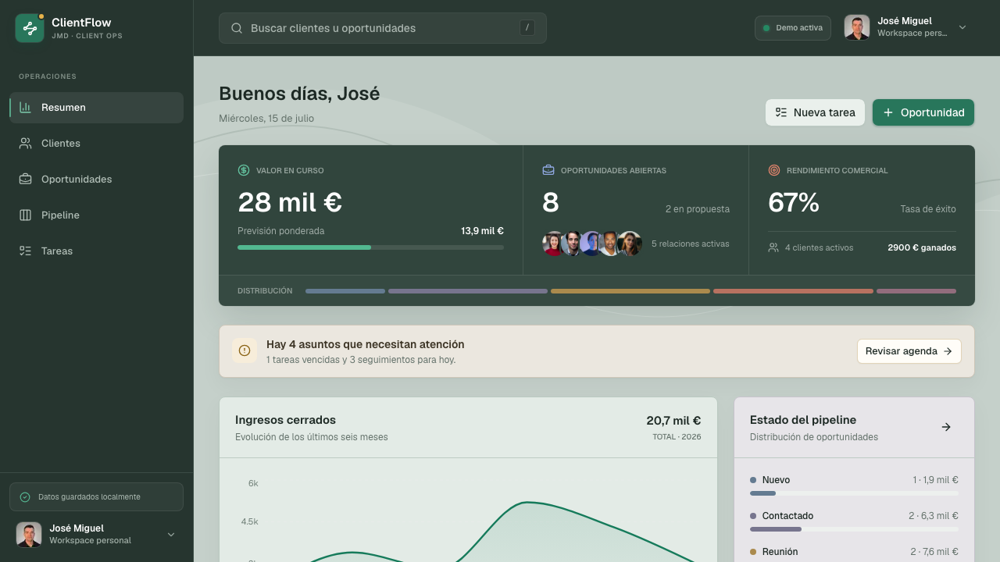
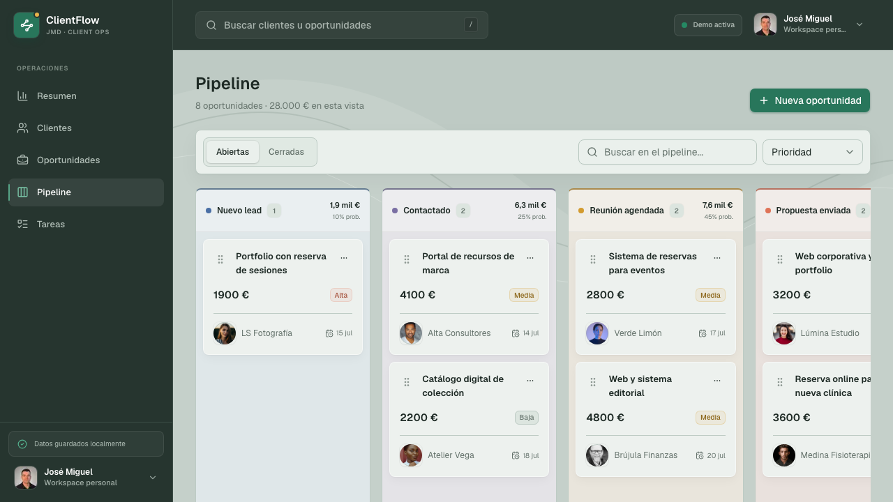
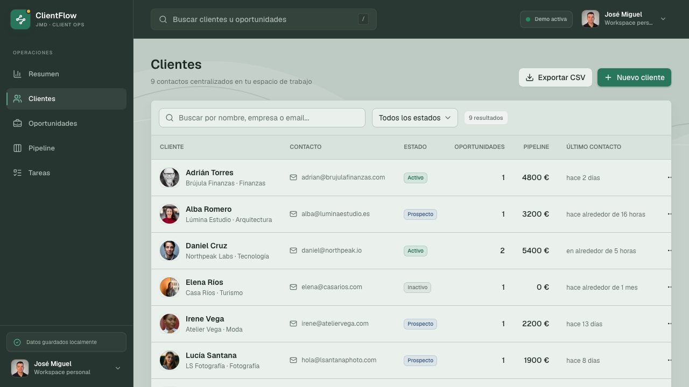
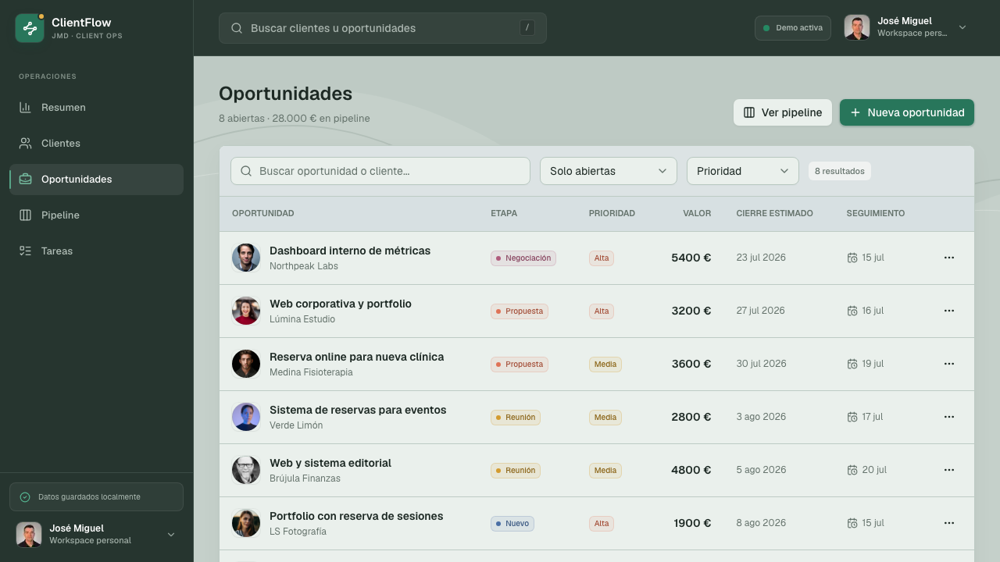
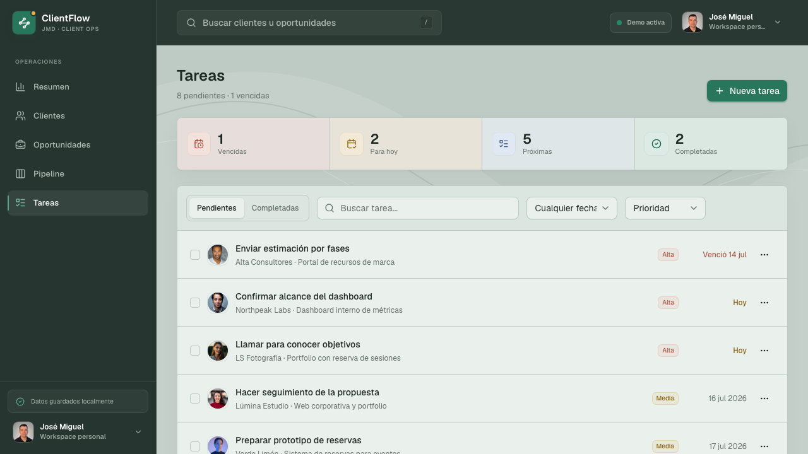
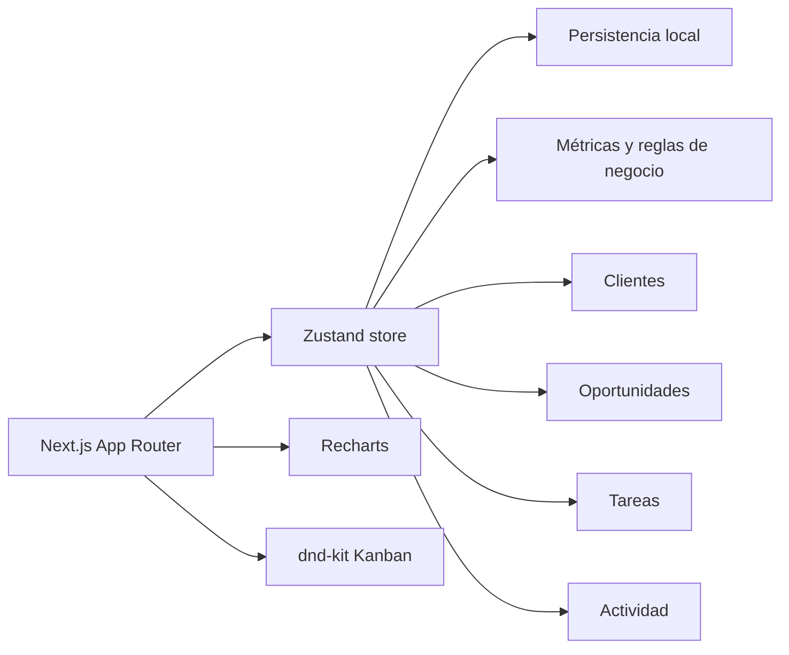

# JMD ClientFlow

[](https://github.com/JMDcore/JMD-ClientFlow/actions/workflows/ci.yml)


CRM ligero para freelancers y pequeños profesionales. Centraliza clientes, oportunidades, tareas y seguimientos en una experiencia visual que prioriza una pregunta: **¿qué necesita atención hoy?**

> Estado: MVP funcional. Los datos de la demo se guardan de forma aislada en el navegador y pueden restaurarse en cualquier momento.



## Producto

ClientFlow está pensado para profesionales que necesitan controlar su actividad comercial sin adoptar un CRM empresarial complejo. La aplicación combina una vista diaria accionable con un pipeline visual y un historial contextual de cada relación.

### Funcionalidades

- Dashboard con pipeline total, previsión ponderada, tasa de éxito y alertas.
- Gestión completa de clientes y oportunidades.
- Pipeline Kanban con movimiento entre etapas.
- Agenda de tareas con vencidas, pendientes y completadas.
- Seguimientos próximos y oportunidades que están perdiendo impulso.
- Historial de notas, emails, llamadas, reuniones y cambios de etapa.
- Búsqueda global, filtros y vistas responsive.
- Exportación de clientes a CSV.
- Datos de demostración restaurables y persistencia local por navegador.



## Galería del producto

|                        Clientes                        |                           Oportunidades                           |
| :----------------------------------------------------: | :---------------------------------------------------------------: |
|  |  |



## Decisiones de producto

- **Acción antes que analítica:** el dashboard destaca tareas y seguimientos que requieren atención.
- **Demo sin registro:** cada visitante puede experimentar con el producto sin modificar los datos de otros usuarios.
- **Previsión realista:** el valor ponderado aplica una probabilidad distinta a cada etapa del pipeline.
- **Modelo preparado para crecer:** clientes, oportunidades, tareas y actividades son entidades relacionadas, no bloques aislados.
- **Sistema visual operativo:** navegación en grafito, superficies neutras y color reservado para acciones, estados y datos relevantes.

## Arquitectura



La primera versión utiliza persistencia local para ofrecer una demo pública segura y sin credenciales. Una evolución SaaS puede sustituir esta capa por PostgreSQL y añadir espacios de trabajo autenticados sin rediseñar la interfaz.

## Stack

- Next.js 16 y React 19
- TypeScript en modo estricto
- Tailwind CSS 4 y shadcn/ui
- Zustand para estado y persistencia
- dnd-kit para el pipeline
- Recharts para visualización
- React Hook Form y Zod
- Vitest y Playwright
- GitHub Actions

## Desarrollo local

Requisitos: Node.js 22 o superior y npm.

```bash
git clone https://github.com/JMDcore/JMD-ClientFlow.git
cd JMD-ClientFlow
npm install
npm run dev
```

Abre [http://localhost:3000](http://localhost:3000).

## Comandos

```bash
npm run dev            # entorno local
npm run build          # compilación de producción
npm run lint           # calidad estática
npm run typecheck      # comprobación de tipos
npm run test           # pruebas unitarias
npm run test:e2e       # pruebas en navegador
npm run format:check   # formato del repositorio
```

## Próximos pasos

- Autenticación y espacios de trabajo personales.
- Persistencia con PostgreSQL.
- Recordatorios y sincronización con calendario.
- Presupuestos y exportación a PDF.
- Asistencia para redactar emails de seguimiento.

---

Diseñado y desarrollado por **José Miguel Díaz**.

Los [retratos de clientes de demostración](public/avatars/README.md) proceden de Unsplash; el usuario principal utiliza el avatar público de `JMDcore`.
