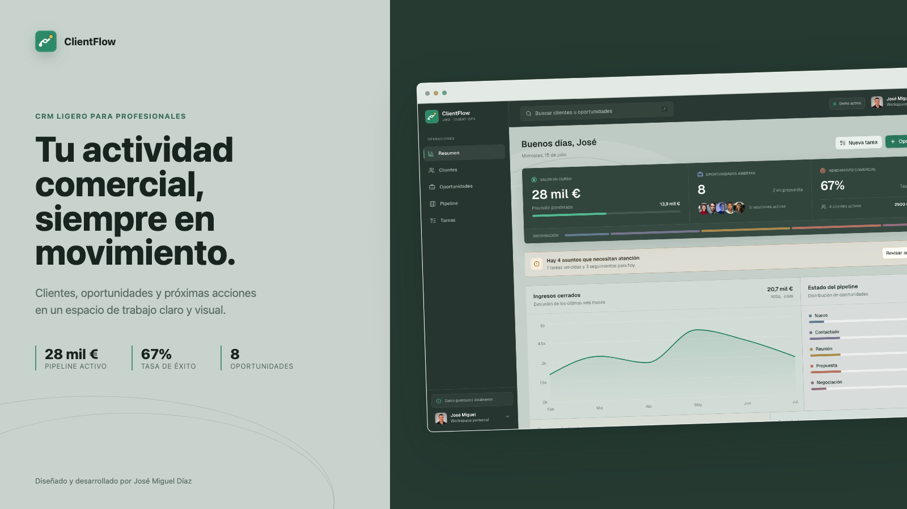
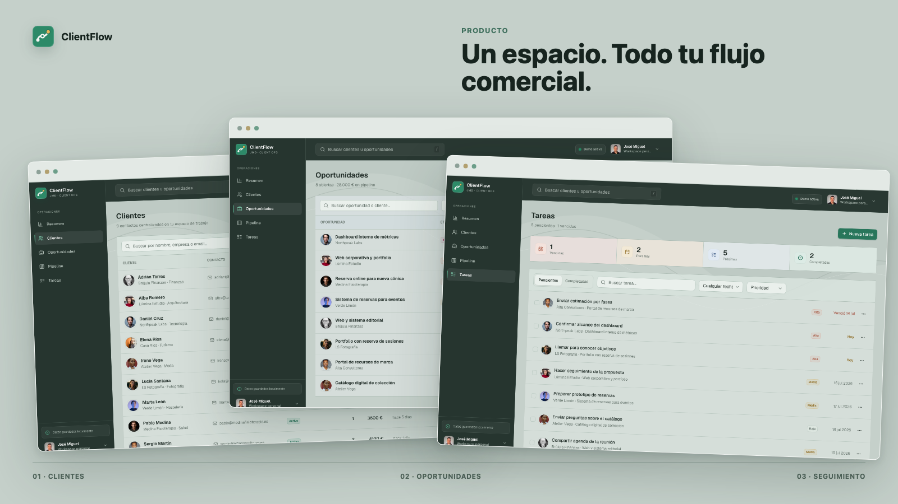
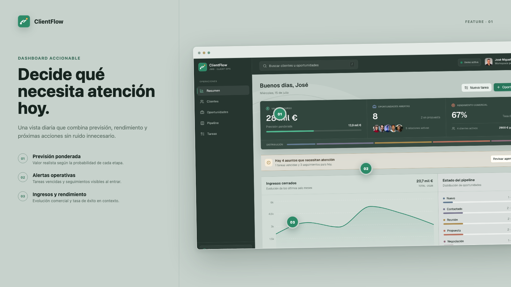
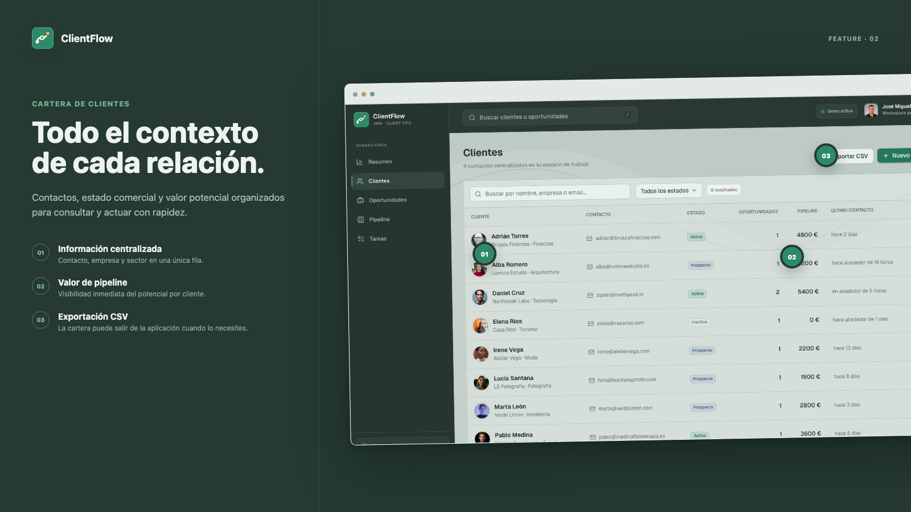
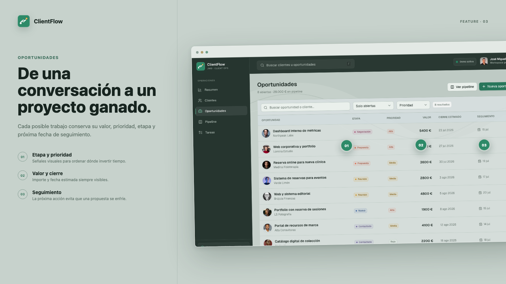
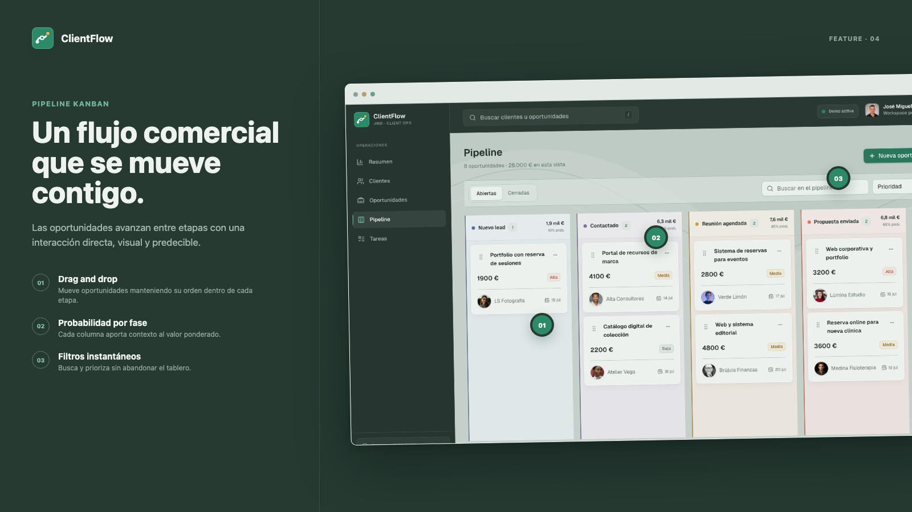
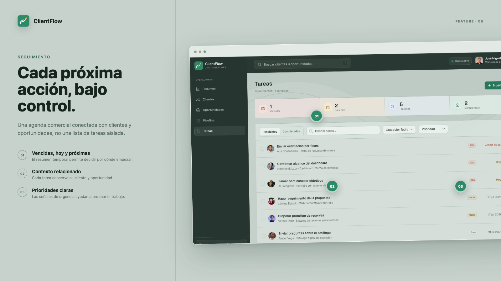
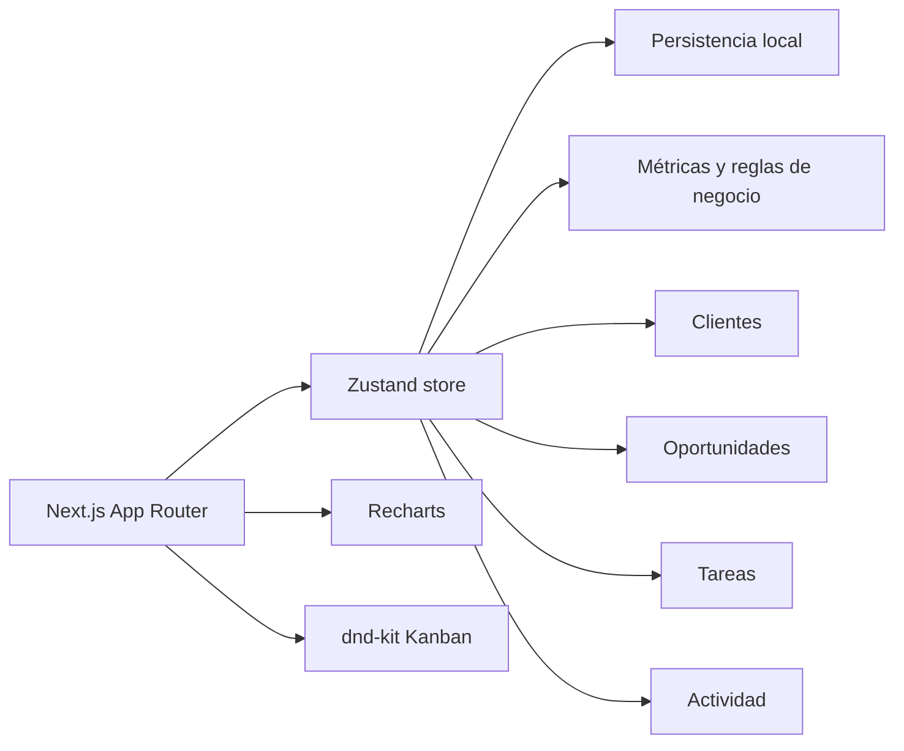

<p align="center">
  <picture>
    <source media="(prefers-color-scheme: dark)" srcset="public/brand/clientflow-lockup-dark.svg">
    <source media="(prefers-color-scheme: light)" srcset="public/brand/clientflow-lockup.svg">
    
  </picture>
</p>

<h1 align="center">JMD ClientFlow</h1>

<p align="center">
  <strong>CRM ligero para freelancers y pequeños profesionales.</strong><br>
  Clientes, oportunidades, pipeline y próximas acciones en un espacio de trabajo claro y visual.
</p>

<p align="center">
  <a href="https://github.com/JMDcore/JMD-ClientFlow/actions/workflows/ci.yml"></a>
  <a href="https://github.com/JMDcore/JMD-ClientFlow/actions/workflows/codeql.yml"></a>
  <a href="LICENSE"></a>
  <a href="https://github.com/JMDcore/JMD-ClientFlow/commits/main"></a>
</p>

<p align="center">
  
  
  
  
  
  
</p>

<p align="center">
  <a href="#el-producto">Producto</a> ·
  <a href="#recorrido-por-funcionalidades">Recorrido visual</a> ·
  <a href="#arquitectura">Arquitectura</a> ·
  <a href="#calidad-y-pruebas">Calidad</a> ·
  <a href="#desarrollo-local">Ejecutar localmente</a>
</p>

> **Estado del proyecto:** MVP funcional, responsive y listo para explorar sin registro. Los datos de la demo permanecen únicamente en el navegador.



## Contenido

- [El producto](#el-producto)
- [Identidad visual](#identidad-visual)
- [Recorrido por funcionalidades](#recorrido-por-funcionalidades)
- [Decisiones de producto](#decisiones-de-producto)
- [Arquitectura](#arquitectura)
- [Estructura del proyecto](#estructura-del-proyecto)
- [Calidad y pruebas](#calidad-y-pruebas)
- [Desarrollo local](#desarrollo-local)
- [Roadmap](#roadmap)

## El producto

ClientFlow está diseñado para profesionales que necesitan controlar su actividad comercial sin adoptar un CRM empresarial complejo. Combina una vista diaria accionable con un pipeline visual y un historial contextual de cada relación.

| Producto                                        | Ingeniería                                            | Calidad                                          |
| ----------------------------------------------- | ----------------------------------------------------- | ------------------------------------------------ |
| Flujos reales de CRM, no pantallas aisladas     | Estado tipado y reglas de negocio separadas de la UI  | CI, pruebas unitarias, E2E y build de producción |
| Dashboard, CRUD y Kanban interactivo            | Componentes reutilizables y persistencia local        | CodeQL, auditoría y revisión de dependencias     |
| Datos demo coherentes para explorar el producto | Arquitectura preparada para evolucionar hacia una API | Responsive verificado en navegador real          |

| Área          | Capacidad                                                                  |
| ------------- | -------------------------------------------------------------------------- |
| Dashboard     | Pipeline, previsión ponderada, tasa de éxito, ingresos y alertas.          |
| Clientes      | CRUD, estado comercial, notas, actividad y exportación CSV.                |
| Oportunidades | Valor, prioridad, etapa, fecha de cierre y próximo seguimiento.            |
| Pipeline      | Kanban con drag and drop, orden por etapa y filtros.                       |
| Tareas        | Vencidas, pendientes, completadas y relacionadas con clientes/proyectos.   |
| Experiencia   | Búsqueda global, filtros, responsive y datos de demostración restaurables. |



## Identidad visual

La marca representa el avance de una relación comercial: contacto, oportunidad y cierre conectados en un único flujo. El recorrido ascendente refuerza la idea de progreso y el nodo dorado señala el siguiente objetivo.

Los recursos oficiales están disponibles en formato vectorial y rasterizado:

- [Símbolo de ClientFlow](public/brand/clientflow-mark.svg)
- [Logotipo horizontal](public/brand/clientflow-lockup.svg)
- [Logotipo para fondos oscuros](public/brand/clientflow-lockup-dark.svg)
- [Símbolo PNG de alta resolución](public/brand/clientflow-mark-512.png)

La misma identidad se utiliza en la interfaz, el favicon, los metadatos sociales y todas las creatividades generadas para la documentación.

La [guía de recursos visuales](docs/SHOWCASE.md) documenta formatos, usos y el proceso reproducible para regenerar las capturas.

## Recorrido por funcionalidades

### 1. Dashboard accionable

La página principal reúne previsión, rendimiento y próximas acciones. No intenta mostrar todos los datos: prioriza aquello que cambia la jornada de trabajo.



### 2. Cartera de clientes

Cada relación mantiene su contexto comercial, datos de contacto y valor potencial. La cartera puede filtrarse, consultarse o exportarse sin perder trazabilidad.



### 3. Gestión de oportunidades

Las oportunidades relacionan cliente, importe, etapa, prioridad, cierre estimado y próxima acción para que una propuesta no se convierta en una fila olvidada.



### 4. Pipeline Kanban

El tablero permite mover oportunidades entre etapas y conserva su orden. Cada fase tiene una probabilidad asociada que alimenta la previsión ponderada.



### 5. Seguimiento y tareas

La agenda separa vencidas, acciones para hoy y próximas tareas. Cada elemento conserva el contexto de su cliente y oportunidad relacionada.



## Decisiones de producto

- **Acción antes que analítica:** el dashboard destaca tareas y conversaciones que requieren atención.
- **Demo sin fricción:** la aplicación puede explorarse sin registro ni configuración inicial.
- **Previsión realista:** el importe ponderado aplica una probabilidad distinta a cada etapa.
- **Entidades relacionadas:** clientes, oportunidades, tareas y actividades comparten contexto.
- **Interfaz operativa:** el color comunica estado y prioridad; la estructura favorece lectura repetida.
- **Privacidad por diseño:** el MVP no envía datos comerciales a un servidor externo.

## Arquitectura



La primera versión utiliza persistencia local para ofrecer una demo pública segura y sin credenciales. La capa de estado mantiene separadas la lógica de negocio y la presentación, permitiendo evolucionar hacia una API y PostgreSQL sin rediseñar los flujos principales.

La explicación completa está en [docs/ARCHITECTURE.md](docs/ARCHITECTURE.md).

## Stack

- Next.js 16, React 19 y TypeScript estricto.
- Tailwind CSS 4 y componentes basados en shadcn/ui.
- Zustand para estado y persistencia local.
- dnd-kit para interacción Kanban.
- Recharts para visualización de métricas.
- React Hook Form y Zod para formularios y validación.
- Vitest, Testing Library y Playwright.
- GitHub Actions para integración continua.

## Estructura del proyecto

```text
JMD-ClientFlow/
├── .github/                 # CI, plantillas de issues y pull requests
├── docs/                    # Decisiones y arquitectura técnica
├── public/
│   ├── avatars/             # Recursos de la demo y sus créditos
│   ├── brand/               # Logotipo y recursos oficiales de marca
│   ├── screenshots/         # Capturas reales de cada vista
│   └── showcase/            # Creatividades para README y LinkedIn
├── scripts/                 # Generadores reproducibles de recursos
├── src/
│   ├── app/                 # Rutas, layout y metadatos
│   ├── components/          # Funciones de producto y UI compartida
│   ├── lib/                 # Tipos, constantes y reglas de negocio
│   └── store/               # Estado, acciones y persistencia
└── tests/e2e/               # Flujos críticos en navegador
```

## Calidad y pruebas

El repositorio aplica las siguientes comprobaciones en cada push y pull request:

- Formato con Prettier.
- Análisis estático con ESLint.
- TypeScript en modo estricto.
- Pruebas unitarias de métricas y estado.
- Pruebas E2E de dashboard, clientes, pipeline y responsive.
- Compilación de producción con Next.js.
- Análisis estático de seguridad con CodeQL.
- Revisión de nuevas dependencias y auditoría de producción.

| Automatización      | Cuándo se ejecuta            | Qué protege                                        |
| ------------------- | ---------------------------- | -------------------------------------------------- |
| `Quality checks`    | Push y pull request          | Formato, lint, tipos, unitarias, E2E y build       |
| `CodeQL`            | Push, pull request y semanal | Patrones vulnerables en JavaScript y TypeScript    |
| `Dependency review` | Pull request                 | Dependencias nuevas con vulnerabilidades conocidas |
| `Dependabot`        | Semanal                      | Actualizaciones agrupadas de npm y GitHub Actions  |

```bash
npm run validate
```

## Desarrollo local

Requisitos: Node.js 22 o superior y npm.

```bash
git clone https://github.com/JMDcore/JMD-ClientFlow.git
cd JMD-ClientFlow
npm ci
npm run dev
```

Abre [http://localhost:3000](http://localhost:3000).

### Comandos

| Comando                 | Uso                                               |
| ----------------------- | ------------------------------------------------- |
| `npm run dev`           | Inicia el entorno local.                          |
| `npm run build`         | Genera la compilación de producción.              |
| `npm run validate`      | Ejecuta formato, lint, tipos y pruebas unitarias. |
| `npm run test:e2e`      | Ejecuta los flujos críticos en Chromium.          |
| `npm run test:coverage` | Genera el informe de cobertura.                   |
| `npm run screenshots`   | Captura las cinco vistas desde la aplicación.     |
| `npm run showcase`      | Regenera las piezas visuales desde las capturas.  |

## Datos de demostración

Los datos se almacenan mediante persistencia local en el navegador. La opción **Restaurar datos** devuelve el workspace a su estado inicial. No se incluyen credenciales, secretos ni conexiones a servicios de terceros.

## Roadmap

- Autenticación y espacios de trabajo personales.
- Persistencia con PostgreSQL.
- Recordatorios y sincronización con calendario.
- Presupuestos y exportación a PDF.
- Asistencia para redactar emails de seguimiento.

## Contribución y seguridad

Las propuestas son bienvenidas siguiendo [CONTRIBUTING.md](CONTRIBUTING.md). Los problemas de seguridad deben comunicarse mediante el proceso descrito en [SECURITY.md](SECURITY.md), no en un issue público.

## Licencia y créditos

Distribuido bajo la [licencia MIT](LICENSE).

Diseñado y desarrollado por **José Miguel Díaz**.

[GitHub](https://github.com/JMDcore) · [Email](mailto:jmdcore.dev@gmail.com)

Los [retratos de clientes de demostración](public/avatars/README.md) proceden de Unsplash; el usuario principal utiliza el avatar público de `JMDcore`.
