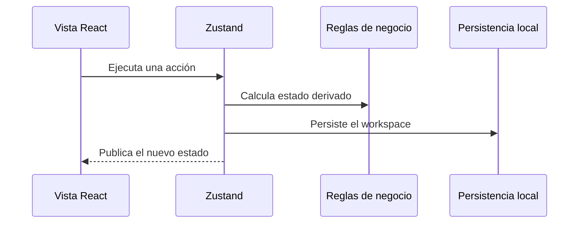
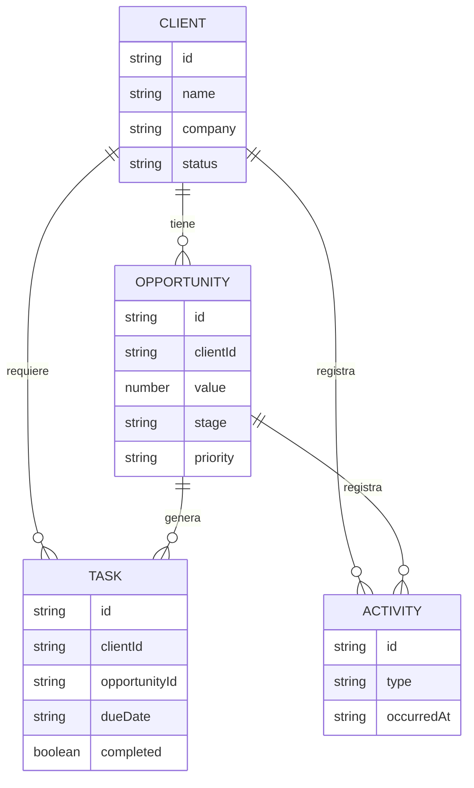

# Arquitectura de ClientFlow

## Objetivo

ClientFlow es un CRM ligero orientado a una persona o microempresa. La arquitectura del MVP favorece una demo pública sin autenticación, una lógica de negocio comprobable y una futura migración a persistencia remota.

## Capas

### Presentación

- `src/app`: rutas, layouts, metadatos y composición de páginas.
- `src/components`: vistas de producto, componentes compartidos y primitivas de UI.
- Los componentes consumen selectores del store y delegan las mutaciones en acciones explícitas.

### Estado y dominio

- `src/store/use-clientflow-store.ts`: estado global, CRUD, restauración y persistencia.
- `src/lib/types.ts`: contratos de clientes, oportunidades, tareas y actividad.
- `src/lib/metrics.ts`: cálculos derivados sin dependencias de React.
- `src/lib/constants.ts`: etapas, probabilidades y configuración visual de estados.

### Persistencia

El MVP utiliza almacenamiento local del navegador. Esta decisión permite que cada visitante experimente con datos aislados sin credenciales ni infraestructura backend.

## Modelo de datos

## Reglas relevantes

- Las etapas abiertas tienen una probabilidad comercial asociada.
- La previsión ponderada suma `valor × probabilidad` para cada oportunidad abierta.
- Ganado y perdido son estados cerrados y no forman parte del pipeline activo.
- Las tareas pueden relacionarse con cliente, oportunidad o ambos.
- Restaurar la demo reemplaza el estado persistido por los datos iniciales.

## Estrategia de pruebas

- Las funciones puras de métricas se prueban con Vitest.
- Las mutaciones y restauración del store se prueban sin navegador real.
- Playwright cubre los flujos críticos y comprueba que la interfaz móvil no desborda el viewport.
- La integración continua ejecuta formato, lint, tipos, unitarias, build y E2E.

## Evolución hacia SaaS

1. Sustituir la persistencia local por un repositorio HTTP.
2. Introducir autenticación y `workspaceId` en las entidades.
3. Migrar el modelo a PostgreSQL manteniendo los tipos de dominio.
4. Ejecutar métricas agregadas en servidor cuando el volumen lo requiera.
5. Incorporar sincronización optimista y tratamiento de conflictos.
